# Tubes MAD (IF3210-24) 2026 - MS1 - K01 - FAR

## Daftar Isi
- [Deskripsi Aplikasi](#deskripsi-aplikasi)
- [Fitur Utama (Milestone 2)](#fitur-utama-milestone-2)
- [Library yang Digunakan (Milestone 2)](#library-yang-digunakan-milestone-2)
- [Pembagian Kerja Anggota Kelompok (Milestone 2)](#pembagian-kerja-anggota-kelompok-milestone-2)
- [Waktu Pengerjaan (Milestone 2)](#waktu-pengerjaan-milestone-2)
- [Screenshot Aplikasi (Milestone 2)](#screenshot-aplikasi-milestone-2)
- [Contributors](#contributors)
- [Analisis dan Perbaikan Keamanan Aplikasi (OWASP)](#analisis-dan-perbaikan-keamanan-aplikasi-owasp)

## Deskripsi Aplikasi
Nimons360 adalah aplikasi Android yang dirancang untuk membantu manajemen dan pelacakan keluarga secara real-time, terinspirasi dari fungsionalitas utama aplikasi Life360. Aplikasi ini memungkinkan pengguna untuk membuat keluarga, memantau lokasi anggota, serta mengelola daftar keluarga dengan fitur pencarian dan penyematan.

## Fitur Utama (Milestone 2)
- **Map Extended** : Sistem mark location, share location, dan open Google Maps.
- **Notifikasi** : Menerima notifikasi secara otomatis dari pesan yang ada di keluarga.
- **Upload Profile Photo & Privacy Toggle** : Mengunggah foto profil dari kamera atau galeri, serta toggle untuk privasi.
- **Share Family** : Mengundang anggota baru menggunakan deep link melalui HTML Link dan QR Code.
- **Responsive** : Mendukung tampilan portrait dan landscape untuk semua halaman tanpa kehilangan data saat rotasi layar.

## Library yang Digunakan (Milestone 2)
- **Material Components** : Implementasi standar komponen antarmuka Material Design 3.
- **Jetpack Compose** : Framework modern untuk membangun UI deklaratif secara penuh.
- **Retrofit & OKHttp** : Client HTTP untuk berkomunikasi dengan REST API secara efisien.
- **GSON & Converter GSON** : Serialisasi dan deserialisasi data JSON menjadi objek model.
- **Room Database** : Penyimpanan data persisten lokal SQLite untuk lokasi favorit dan keluarga tersemat.
- **Kotlinx Coroutines** : Library untuk menangani operasi asinkron secara non-blocking.
- **Lifecycle (ViewModel, Runtime, Compose)** : Manajemen state aplikasi dan data UI selama siklus hidup komponen.
- **Security Crypto** : Enkripsi token sesi menggunakan EncryptedSharedPreferences.
- **Coil & Coil Compose** : Library pemuatan gambar dan avatar secara asinkron dengan performa tinggi.
- **OSMDroid** : Integrasi dan rendering peta interaktif menggunakan sumber OpenStreetMap.
- **Google Play Services Location** : API untuk pengambilan data lokasi presisi dan koordinat GPS.
- **SwipeRefreshLayout** : Komponen UI untuk fitur pull down to refresh pada layout XML.
- **ZXing (Core & Android Embedded)** : Library untuk meng-generate dan memindai QR Code untuk fitur Share Family.
- **Firebase Cloud Messaging (FCM)** : Layanan push notification cloud untuk menerima siaran pesan secara real-time.

## Pembagian Kerja Anggota Kelompok (Milestone 2)
| Spesifikasi | Kontributor |
| :--- | :---: |
| **Wajib - Map Extended** | 13523005 |
| **Wajib - Notifikasi** | 13523035 |
| **Wajib - Upload Profile Photo & Privacy Toggle** | 13523021 |
| **Wajib - Share Family** | 13523021 |
| **Wajib - Responsive** | 13523005 & 13523021 & 13523035 |
| **Wajib - OWASP**| 13523035 |
| **Wajib - OpenAPI** | 13523035 |
| **Bonus - Share Story Instagram** | None |
| **Bonus - Analytics** | None |
| **Bonus - Share Family Via QR Code** | 13523021 |
| **Bonus - Customizable Icon** | None |
| **Bonus - Accessibility Testing** | None |

## Waktu Pengerjaan (Milestone 2)
| NIM | Jam Persiapan | Jam Pengerjaan | Total Jam |
| :---: | :---: | :---: | :---: |
| **13523005** | 2 Jam | 30 Jam | 32 Jam |
| **13523021** | 2 Jam | 30 Jam | 32 Jam |
| **13523035** | 2 Jam | 30 Jam | 32 Jam |

## Screenshot Aplikasi (Milestone 2)

### Wajib - Map Extended
<table>
  <tr>
    <td align="center">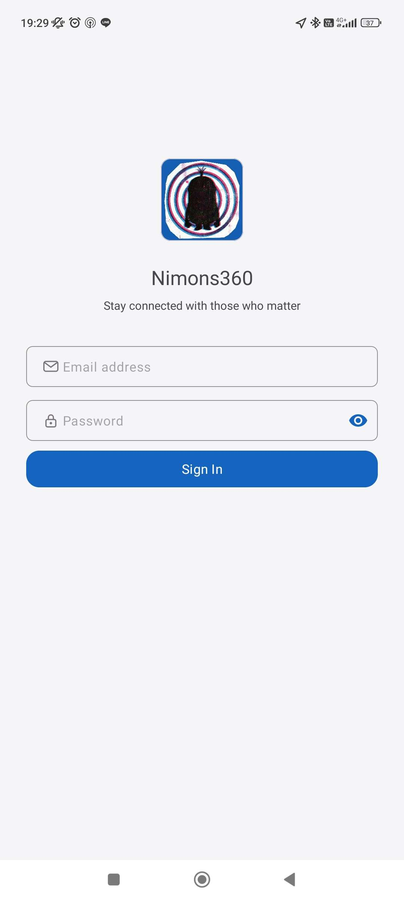<br><b>Login (Input)</b></td>
    <td align="center">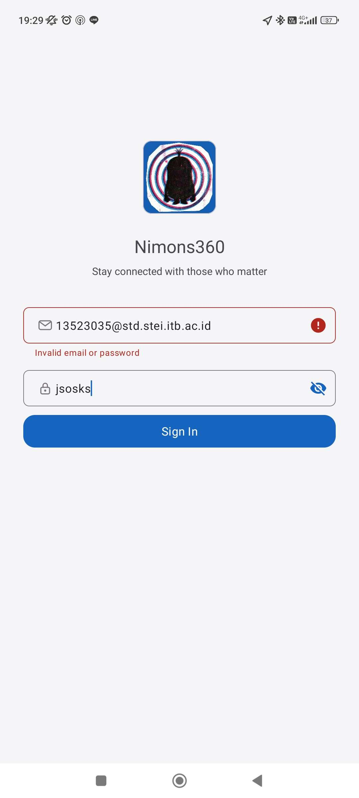<br><b>Login (Failed)</b></td>
    <td align="center">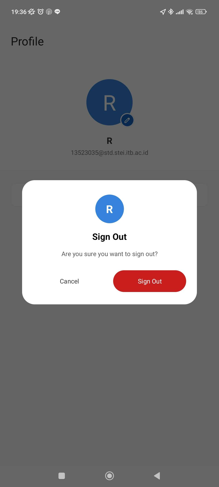<br><b>Logout</b></td>
  </tr>
</table>

### Wajib - Notifikasi
<table>
  <tr>
    <td align="center"><br><b>Family Detail Actions</b></td>
    <td align="center"><br><b>Send Message</b></td>
    <td align="center"><br><b>Greeting</b></td>
    <td align="center"><br><b>Notifikasi Diterima</b></td>
  </tr>
</table>

### Wajib - Profile Photo
<table>
  <tr>
    <td align="center">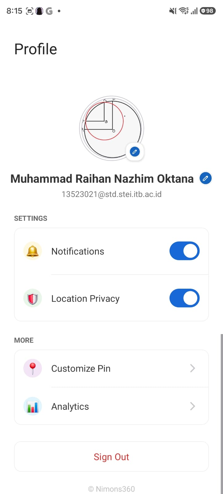<br><b>Halaman Profile Baru</b></td>
    <td align="center">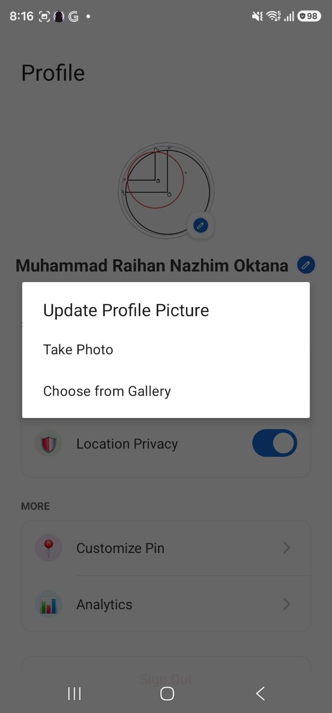<br><b>Opsi Pemilihan Foto</b></td>
    <td align="center">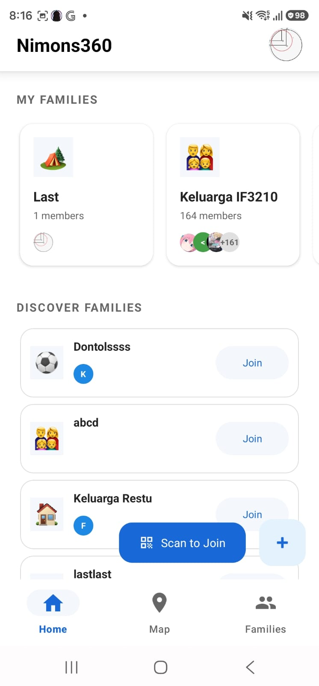<br><b>Home (Profile Picture)</b></td>
    <td align="center">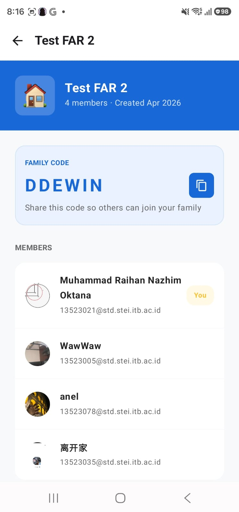<br><b>Family Detail (Profile Picture)</b></td>
  </tr>
</table>

### Wajib - Share Family
<table>
  <tr>
    <td align="center"><br><b>Share Family Modal</b></td>
    <td align="center"><br><b>Share as Link Chat</b></td>
    <td align="center"><br><b>Share as Link HTML</b></td>
  </tr>
  <tr>
    <td align="center"><br><b>Share as QR Code Chat</b></td>
    <td align="center"><br><b>Scan QR Code</b></td>
  </tr>
</table>

### Wajib - Responsive (Halaman-halaman Landscape)
<table>
  <tr>
    <td align="center"><br><b>Login</b></td>
    <td align="center"><br><b>Home</b></td>
    <td align="center"><br><b>Profile</b></td>
    <td align="center"><br><b>Map</b></td>
  </tr>
  <tr>
    <td align="center"><br><b>Family Detail</b></td>
    <td align="center"><br><b>Families</b></td>
    <td align="center"><br><b>Create Family</b></td>
  </tr>
</table>


## Contributors

<table>
  <tr>
    <td align="center">
      <a href="https://github.com/malfansya">
        <br />
        <span><b>Muhammad Alfansya</b></span><br/>
        <p>13523005 </p>
      </a>
    </td>
    <td align="center">
      <a href="https://github.com/RNXFreeze">
        <br />
        <span><b>Muhammad Raihan Nazhim Oktana</b></span><br/>
        <p>13523021</p>
      </a>
    </td>
    <td align="center">
      <a href="https://github.com/grwna">
        <br />
        <span><b>M. Rayhan Farrukh</b></span><br/>
        <p>13523035</p>
      </a>
    </td>
  </tr>
</table>

## Analisis dan Perbaikan Keamanan Aplikasi (OWASP)
### Implementasi Praktik Keamanan
Berikut merupakan cuplikan kode yang menunjukkan implementasi dari masing-masing praktik keamanan pada aplikasi.

- **Input Validation pada Form**:
  Cuplikan kode Input Validation pada form login `LoginActivity.kt`, mencakup validasi kelengkapan data, format email, serta batas panjang minimum dan maksimum untuk mencegah payload berlebih ke server:
  ```kotlin
  var isValid = true

  if (email.isEmpty()) {
      binding.emailInputLayout.error = "Email is required"
      isValid = false
  } else if (email.length > 320) {
      binding.emailInputLayout.error = "Email is too long (max 320 characters)"
      isValid = false
  } else if (!android.util.Patterns.EMAIL_ADDRESS.matcher(email).matches()) {
      binding.emailInputLayout.error = "Invalid email format"
      isValid = false
  }

  if (password.isEmpty()) {
      binding.passwordInputLayout.error = "Password is required"
      isValid = false
  } else if (password.length < 8) {
      binding.passwordInputLayout.error = "Password must be at least 8 characters"
      isValid = false
  } else if (password.length > 128) {
      binding.passwordInputLayout.error = "Password is too long (max 128 characters)"
      isValid = false
  }

  if (isValid) {
      authViewModel.login(LoginRequest(email, password))
  }
  ```

- **Penyimpanan Data Sensitif Secara Aman**:
  Penyimpanan token JWT dilakukan menggunakan `EncryptedSharedPreferences` dengan masterkey hardware-backed Keystore agar data kredensial terenkripsi secara aman.
  Cuplikan kode ada pada `SessionManager.kt`:
  ```kotlin
  private val masterKey = MasterKey.Builder(context).setKeyScheme(MasterKey.KeyScheme.AES256_GCM).build()

  private val sharedPreferences: SharedPreferences =
          EncryptedSharedPreferences.create(
                  context,
                  "auth_prefs",
                  masterKey,
                  EncryptedSharedPreferences.PrefKeyEncryptionScheme.AES256_SIV,
                  EncryptedSharedPreferences.PrefValueEncryptionScheme.AES256_GCM
          )
  ```

- **Penggunaan Koneksi Aman (HTTPS)**:
  Semua komunikasi dengan server backend diarahkan melalui HTTPS untuk koneksi yang aman.
  Pengaturan network security pada `network_security.xml` :
  ```xml
  <?xml version="1.0" encoding="utf-8"?>
  <network-security-config>
      <base-config cleartextTrafficPermitted="false">
          <trust-anchors>
              <certificates src="system" />
          </trust-anchors>
      </base-config>
  </network-security-config>
  ```

- **Error Handling Tanpa Mengekspos Informasi Sensitif**:
  Kode dengan potensi error diamankan menggunakan blok try-catch untuk menampilkan pesan error tertentu atau generik yang ramah pengguna, tanpa mengekspos informasi sensitif ke UI.
  Cuplikan penanganan error pada `ProfileViewModel.kt` untuk menangani pengunggahan foto profil:
  ```kotlin
  else {
      val errorMsg = try {
          val json = org.json.JSONObject(response.errorBody()?.string() ?: "")
          json.getString("message")
      } catch (e: Exception) {
          if (response.code() == 413) "File size is too big (Max 500 KB)" else "Failed to upload photo"
      }
      _profileState.value = ProfileState.Error(errorMsg)
  }
  ```

### Analisis Owasp Top 10
Analisis keamanan kami lakukan menggunakan tools static analysis yaitu SonarQube. Adapun metrik yang kami perhatikan adalah *Security* dan *Security Hotspot*. Berikut hasil analisis awal dan hasil analisis setelah perbaikan.

#### Hasil Sebelum Perbaikan
<div align="center">
  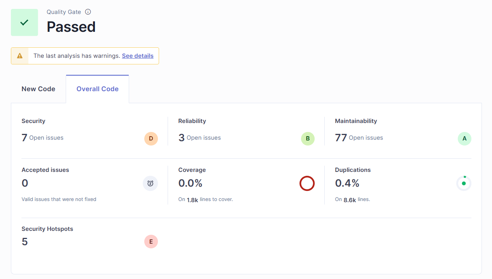
</div>

Seperti yang terlihat pada gambar, terdapat 7 issue *Security* dan 5 issue *Security Hotspot*. Adapun issue-issue yang ditemukan adalah sebagai berikut.

**Security**

<div align="center">
  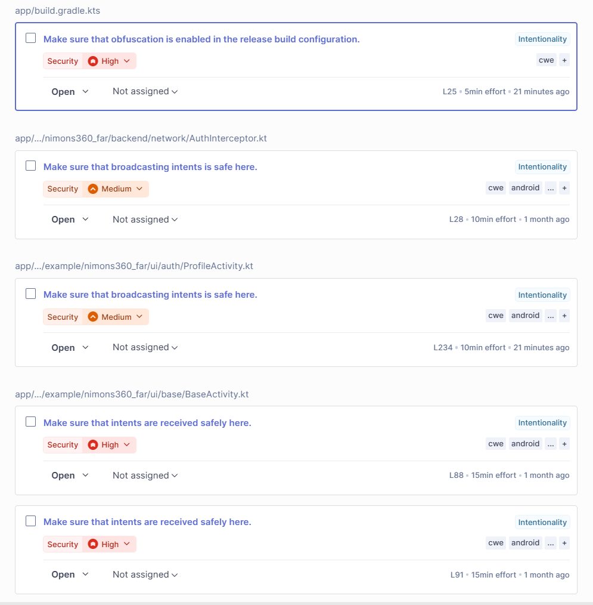
</div>

Pada gambar hanya 5 issue yang ditampilkan, tetapi 2 issue lainnya adalah "Make sure that intents are received safely here".

**Security Hotspot**

<div align="center">
  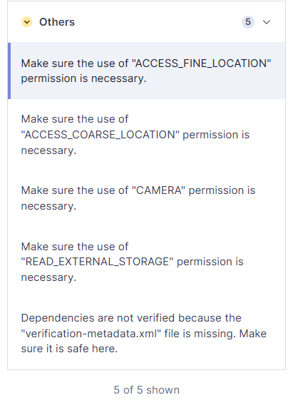
</div>

<br>

**Pengelompokkan Issue**
- M4: Insufficient Input/Output Validation
	- Make sure that intents are received safely here. (`BaseActivity.kt`, `LocationTrackingService.kt`)
  - Make sure that broadcasting intents is safe here.(`AuthInterceptor.kt`, `ProfileActivity.kt`) 
- M8: Security Misconfiguration
	- Make sure that obfuscation is enabled in the release build configuration.
  - Make sure the use of "..." permission is necessary.
  - Dependencies are not verified because the "verification-metadata.xml" file is missing. Make sure it is safe here.
- M9: Insecure Data Storage
	- Tidak ada

#### Perbaikan yang Dilakukan
- **Make sure that intents are received safely here. (`BaseActivity.kt`, `LocationTrackingService.kt`)**
  - `BaseActivity.kt`: `registerReceiver()` tanpa security flag memungkinkan aplikasi lain mengirimkan broadcast ke receiver. Kami memperbaiki ini dengan menambahkan flag `Context.RECEIVER_NOT_EXPORTED`, sehingga receiver hanya menerima broadcast dari dalam aplikasi sendiri. 
  - `LocationTrackingService.kt`: Masalahnya adalah battery receiver dan GPS provider receiver diregister tanpa flag keamanan, sehingga rentan terhadap broadcast injection. Kami perbaiki dengan menambahkan branching `Build.VERSION.SDK_INT >= TIRAMISU` dan menggunakan flag `RECEIVER_NOT_EXPORTED` agar receiver tidak dapat diakses dari aplikasi lain.

- **Make sure that broadcasting intents is safe here.(`AuthInterceptor.kt`, `ProfileActivity.kt`)**
  - Penggunaan `sendBroadcast()` secara default akan mengirim broadcast ke semua aplikasi di device. Namun, kedua file sudah menggunakan `intent.setPackage(context.packageName)` yang membatasi broadcast hanya ke package aplikasi sendiri. Ini merupakan best practice yang direkomendasikan Google sebagai pengganti `LocalBroadcastManager` yang sudah deprecated. Oleh karena itu, issue ini kami nilai sebagai false-positive dari SonarQube, dan kami abaikan.

- **Make sure that obfuscation is enabled in the release build configuration.**
  - Masalahnya ada pada konfigurasi `isMinifyEnabled = false` di build release yang menyebabkan APK berisi nama class, method, dan field yang masih dapat dibaca, sehingga mudah di-reverse engineer. Kami perbaiki dengan mengubah `isMinifyEnabled` menjadi `true` dan menambahkan `isShrinkResources = true` pada `build.gradle.kts`. Dengan ini, R8/ProGuard akan melakukan obfuscation pada APK release. File `proguard-rules.pro` juga diperbarui dengan keep rules yang diperlukan agar model Retrofit dan library lainnya tetap berfungsi.

- **Make sure the use of "..." permission is necessary.**
  - Kami nilai izin yang diperlukan aplikasi memang benar-benar diperlukan oleh fitur aplikasi, sehingga kami tandai ini sebagai Safe.

- **Dependencies are not verified because the "verification-metadata.xml" file is missing. Make sure it is safe here.**
  - Tanpa file `verification-metadata.xml`, Gradle tidak memverifikasi checksum dependency yang diunduh sehingga berpotensi terjadi supply chain attack. Untuk memperbaiki, perlu menghasilkan file besar yang harus di-maintain setiap kali dependency di-update. Oleh karena itu, kami pilih untuk tidak memperbaikinya (tandai Safe).

#### Hasil Setelah Perbaikan
<div align="center">
  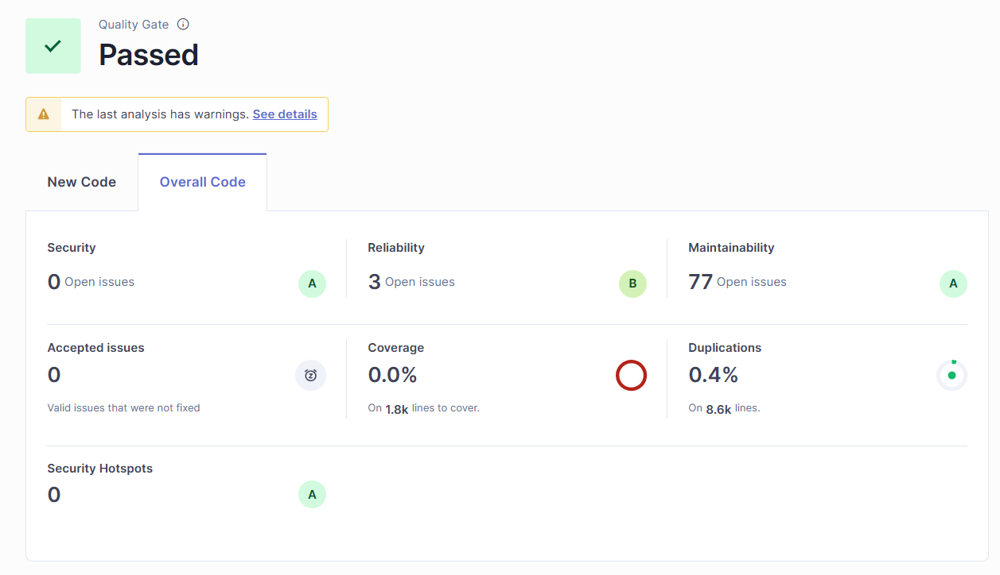
</div>

Seperti yang terlihat pada gambar, issue *Security* dan *Security Hotspot* telah berkurang menjadi 0.
