# Tubes MAD (IF3210-24) 2026 - MS1 - K01 - FAR

## Deskripsi Aplikasi
Nimons360 adalah aplikasi Android yang dirancang untuk membantu manajemen dan pelacakan keluarga secara real-time, terinspirasi dari fungsionalitas utama aplikasi Life360. Aplikasi ini memungkinkan pengguna untuk membuat keluarga, memantau lokasi anggota, serta mengelola daftar keluarga dengan fitur pencarian dan penyematan.

## Fitur Utama
- **Autentikasi Pengguna** : Sistem Login dan Logout yang aman.
- **Manajemen Keluarga** : Membuat, bergabung, meninggalkan, dan melihat detail keluarga.
- **Pelacakan Lokasi** : Integrasi Map dan GPS untuk memantau anggota keluarga secara real-time.
- **Interaksi Interaktif** : Fitur pencarian, filter, dan penyematan keluarga.
- **Profil Pengguna** : Pengelolaan informasi akun dan sesi.

## Library yang Digunakan
- **Material Components** : Implementasi standar komponen antarmuka Material Design 3.
- **Jetpack Compose** : Framework modern untuk membangun UI deklaratif secara penuh.
- **Retrofit & OKHttp** : Client HTTP untuk berkomunikasi dengan REST API secara efisien.
- **GSON & Retrofit Converter GSON** : Serialisasi dan deserialisasi data JSON menjadi objek model.
- **Room Database** : Sistem manajemen database lokal (ORM) untuk penyimpanan data persisten.
- **Kotlinx Coroutines** : Library untuk menangani operasi asinkron dan concurrency.
- **Lifecycle (ViewModel, Runtime, Compose)** : Manajemen state aplikasi dan data UI.
- **Security Crypto** : Implementasi enkripsi untuk penyimpanan data sensitif (EncryptedSharedPreferences).
- **Coil & Coil Compose** : Library pemuatan gambar yang dioptimalkan untuk performa tinggi, termasuk dukungan Compose.
- **OSMDroid** : Integrasi dan rendering peta interaktif menggunakan sumber OpenStreetMap.
- **Google Play Services Location** : API untuk pengambilan data lokasi presisi dan koordinat GPS.
- **SwipeRefreshLayout** : Komponen UI untuk fitur "pull down to refresh" pada layout XML.

## Pembagian Kerja Anggota Kelompok
| Spesifikasi | UI Framework | Kontributor |
| :--- | :--- | :---: |
| **Wajib - Auth** | XML | 13523035 |
| **Wajib - Header & Navbar** | XML | 13523035 |
| **Wajib - Home** | XML | 13523035 |
| **Wajib - Families** | XML (Create Family) & Jetpack Compose (Other) | 13523021 |
| **Wajib - Map** | Jetpack Compose | 13523005 |
| **Wajib - Profile** | XML | 13523035 |
| **Wajib - Network Sensing** | Jetpack Compose | 13523035 |
| **Wajib - OpenAPI** | None | 13523035 |
| **Wajib - README** | None | 13523021 |
| **Bonus - Search Family** | Jetpack Compose | 13523021 |
| **Bonus - Internet Status** | Jetpack Compose | 13523005 |
| **Bonus - Livestreaming** | None | None |
| **Bonus - Mark Favorite Location** | Jetpack Compose | 13523005 |
| **Bonus - Accessibility Testing** | None | None |

## Waktu Pengerjaan
| NIM | Jam Persiapan | Jam Pengerjaan | Total Jam |
| :---: | :---: | :---: | :---: |
| **13523005** | 6 Jam | 30 Jam | 36 Jam |
| **13523021** | 6 Jam | 30 Jam | 36 Jam |
| **13523035** | 6 Jam | 30 Jam | 36 Jam |

## Screenshot Aplikasi

### Wajib - Preview Aplikasi
- **Logo (Display)** 

### Wajib - Auth
<table>
  <tr>
    <td align="center"> <b>Login (Input)</b></td>
    <td align="center"> <b>Login (Failed)</b></td>
    <td align="center"> <b>Logout</b></td>
  </tr>
</table>

### Wajib - Home
<table>
  <tr>
    <td align="center">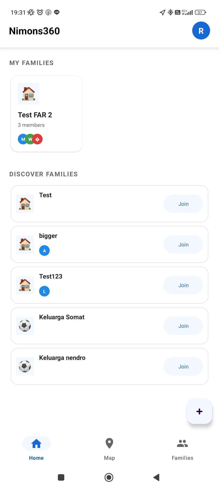 <b>Home</b></td>
    <td align="center">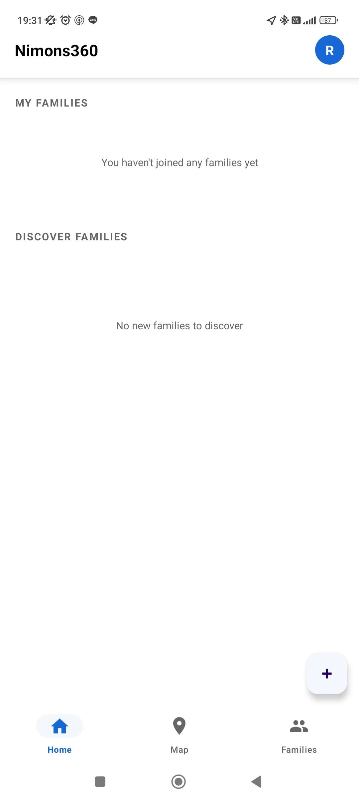 <b>Home (Empty)</b></td>
  </tr>
</table>

### Wajib - Families
<table>
  <tr>
    <td align="center"> <b>Create Family (Input)</b></td>
    <td align="center"> <b>Create Family (Success)</b></td>
    <td align="center"> <b>Create Family (Failed)</b></td>
  </tr>
  <tr>
    <td align="center"> <b>Family Detail (Joined)</b></td>
    <td align="center"> <b>Family Detail (Not Joined)</b></td>
    <td align="center"> <b>Join Family (Input)</b></td>
  </tr>
  <tr>
    <td align="center"> <b>Join (Error Length)</b></td>
    <td align="center"> <b>Join (Wrong Code)</b></td>
    <td align="center"> <b>Leave (Display)</b></td>
  </tr>
  <tr>
    <td align="center"> <b>Pinned (Display)</b></td>
    <td align="center"> <b>Pinned (Add)</b></td>
    <td align="center"> <b>Pinned (Delete)</b></td>
  </tr>
  <tr>
    <td align="center"> <b>Filter (All)</b></td>
    <td align="center"> <b>Filter (My > 0)</b></td>
    <td align="center"> <b>Filter (My = 0)</b></td>
  </tr>
</table>

### Wajib - Map
<table>
  <tr>
    <td align="center">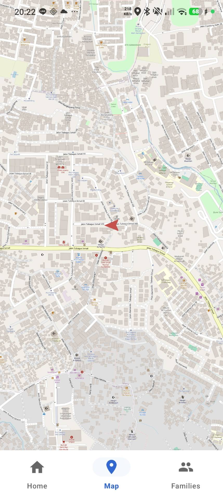 <b>Map (Display)</b></td>
    <td align="center">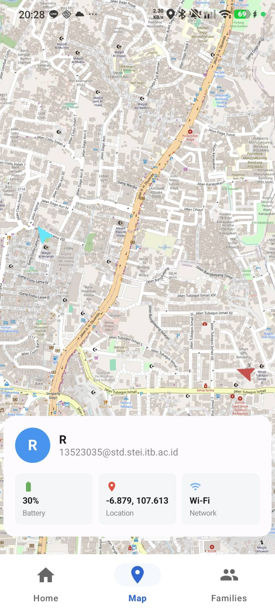 <b>Family Location</b></td>
  </tr>
  <tr>
    <td align="center">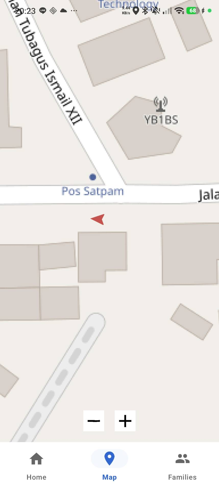 <b>Phone Orientation</b></td>
    <td align="center">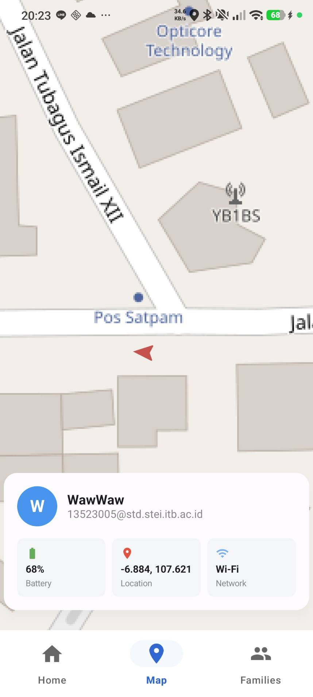 <b>User Information</b></td>
  </tr>
</table>

### Wajib - Profile
<table>
  <tr>
    <td align="center">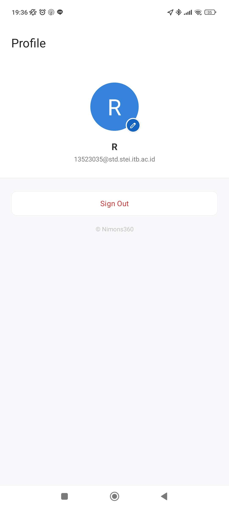 <b>Profile Main</b></td>
    <td align="center">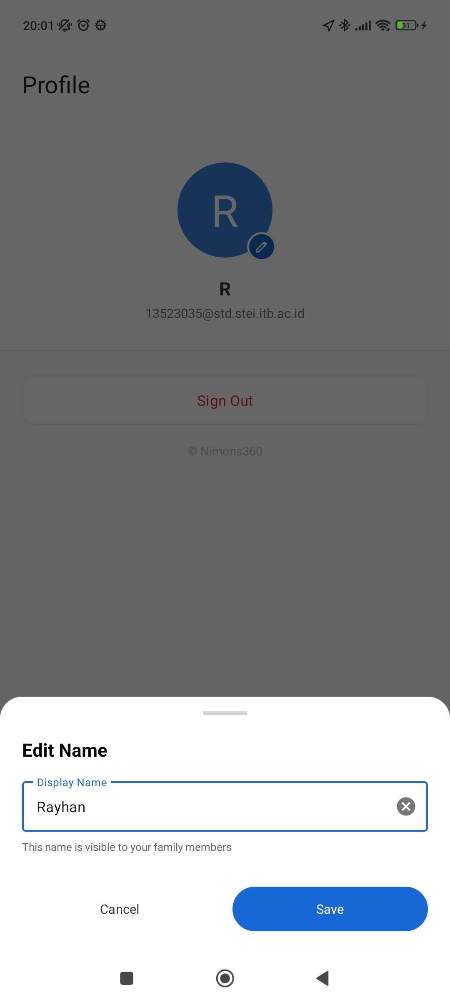 <b>Rename Profile</b></td>
    <td align="center">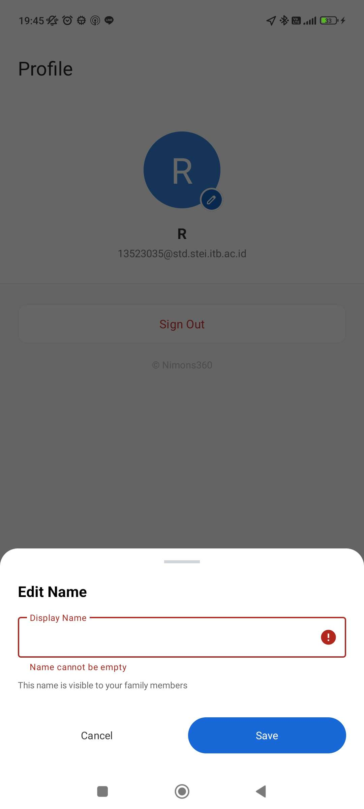 <b>Rename (Failed)</b></td>
  </tr>
</table>

### Wajib - Network Sensing
- **Disconnected** 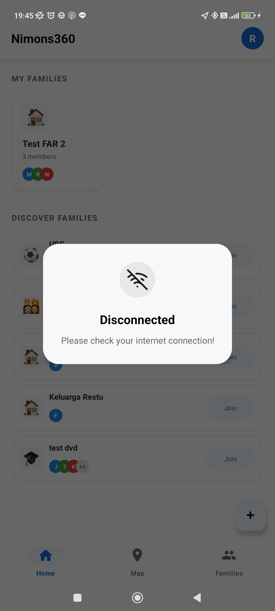

### Bonus - Search Family
<table>
  <tr>
    <td align="center"> <b>All (Found)</b></td>
    <td align="center"> <b>All (Not Found)</b></td>
  </tr>
  <tr>
    <td align="center"> <b>My (Found)</b></td>
    <td align="center"> <b>My (Not Found)</b></td>
  </tr>
</table>

### Bonus - Internet Status
- **Internet Status Wi-Fi (Display)** 
- **Internet Status Cellular (Display)** 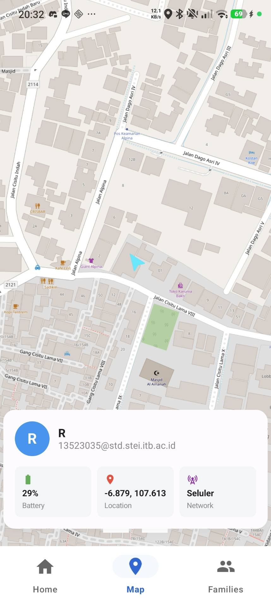

### Bonus - Mark Favorite Location
<table>
  <tr>
    <td align="center">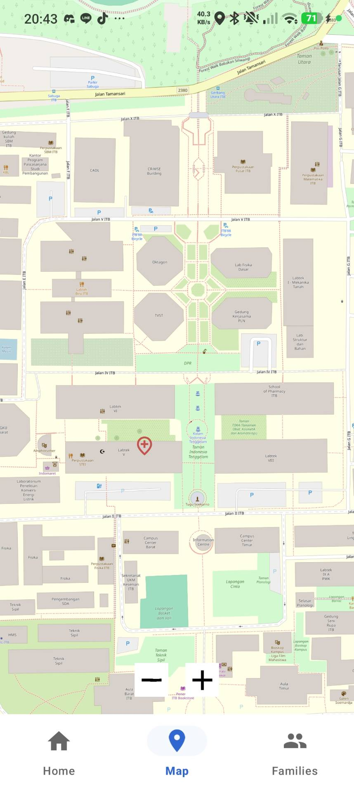 <b>Map View</b></td>
    <td align="center">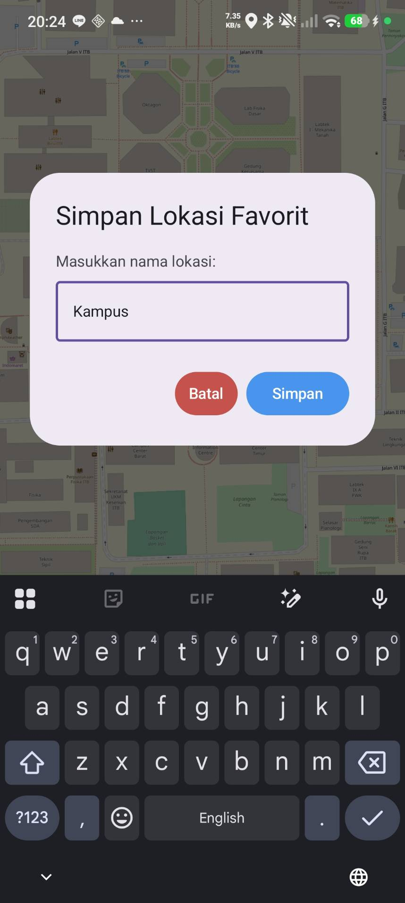 <b>Add (Success)</b></td>
    <td align="center">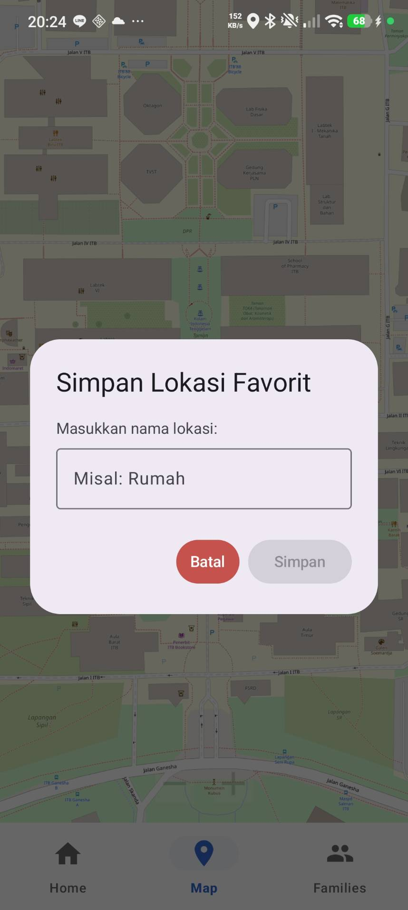 <b>Add (Failed)</b></td>
  </tr>
  <tr>
    <td align="center">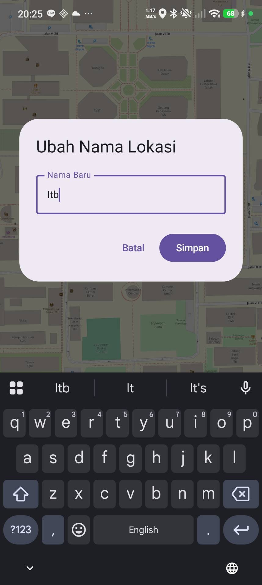 <b>Rename (Success)</b></td>
    <td align="center">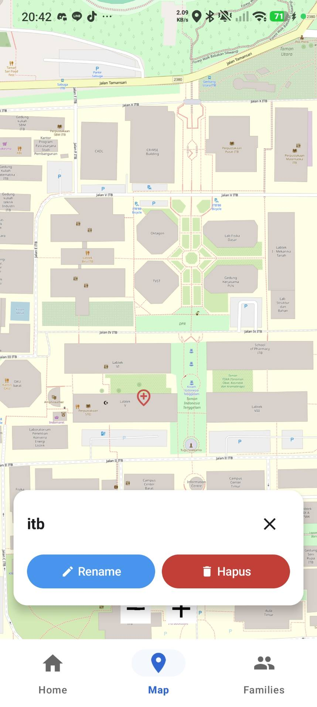 <b>Rename (Failed)</b></td>
    <td align="center">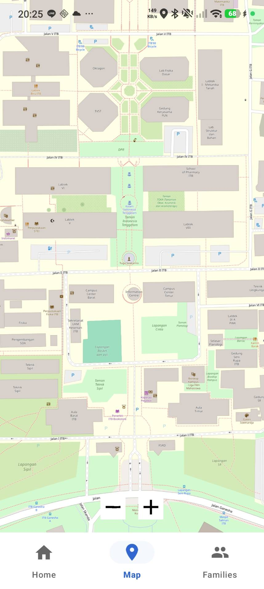 <b>Delete (Display)</b></td>
  </tr>
</table>

## Contributors

<table>
  <tr>
    <td align="center">
      <a href="https://github.com/malfansya">
         
        <b>Muhammad Alfansya</b> 
        
13523005 

      </a>
    </td>
    <td align="center">
      <a href="https://github.com/RNXFreeze">
         
        <b>Muhammad Raihan Nazhim Oktana</b> 
        
13523021

      </a>
    </td>
    <td align="center">
      <a href="https://github.com/grwna">
         
        <b>M. Rayhan Farrukh</b> 
        
13523035

      </a>
    </td>
  </tr>
</table>
