# Tubes MAD (IF3210-24) 2026 - MS1 - K01 - FAR

## Deskripsi Aplikasi
Nimons360 adalah aplikasi Android yang dirancang untuk membantu manajemen dan pelacakan keluarga secara real-time, terinspirasi dari fungsionalitas utama aplikasi Life360. Aplikasi ini memungkinkan pengguna untuk membuat keluarga, memantau lokasi anggota, serta mengelola daftar keluarga dengan fitur pencarian dan penyematan.

## Fitur Utama (Milestone 2)
- **Autentikasi Pengguna** : Sistem Login dan Logout yang aman.
- **Manajemen Keluarga** : Membuat, bergabung, meninggalkan, dan melihat detail keluarga.
- **Pelacakan Lokasi** : Integrasi Map dan GPS untuk memantau anggota keluarga secara real-time.
- **Interaksi Interaktif** : Fitur pencarian, filter, dan penyematan keluarga.
- **Profil Pengguna** : Pengelolaan informasi akun dan sesi.

## Library yang Digunakan
- **Material Components** : Implementasi standar komponen antarmuka Material Design 3.
- **Jetpack Compose** : Framework modern untuk membangun UI deklaratif secara penuh.
- **Retrofit & OKHttp** : Client HTTP untuk berkomunikasi dengan REST API secara efisien.
- **GSON & Retrofit Converter GSON** : Serialisasi dan deserialisasi data JSON menjadi objek model.
- **Room Database** : Sistem manajemen database lokal (ORM) untuk penyimpanan data persisten.
- **Kotlinx Coroutines** : Library untuk menangani operasi asinkron dan concurrency.
- **Lifecycle (ViewModel, Runtime, Compose)** : Manajemen state aplikasi dan data UI.
- **Security Crypto** : Implementasi enkripsi untuk penyimpanan data sensitif (EncryptedSharedPreferences).
- **Coil & Coil Compose** : Library pemuatan gambar yang dioptimalkan untuk performa tinggi, termasuk dukungan Compose.
- **OSMDroid** : Integrasi dan rendering peta interaktif menggunakan sumber OpenStreetMap.
- **Google Play Services Location** : API untuk pengambilan data lokasi presisi dan koordinat GPS.
- **SwipeRefreshLayout** : Komponen UI untuk fitur "pull down to refresh" pada layout XML.

## Pembagian Kerja Anggota Kelompok
| Spesifikasi | UI Framework | Kontributor |
| :--- | :--- | :---: |
| **Wajib - Auth** | XML | 13523035 |
| **Wajib - Header & Navbar** | XML | 13523035 |
| **Wajib - Home** | XML | 13523035 |
| **Wajib - Families** | XML (Create Family) & Jetpack Compose (Other) | 13523021 |
| **Wajib - Map** | Jetpack Compose | 13523005 |
| **Wajib - Profile** | XML | 13523035 |
| **Wajib - Network Sensing** | Jetpack Compose | 13523035 |
| **Wajib - OpenAPI** | None | 13523035 |
| **Wajib - README** | None | 13523021 |
| **Bonus - Search Family** | Jetpack Compose | 13523021 |
| **Bonus - Internet Status** | Jetpack Compose | 13523005 |
| **Bonus - Livestreaming** | None | None |
| **Bonus - Mark Favorite Location** | Jetpack Compose | 13523005 |
| **Bonus - Accessibility Testing** | None | None |

## Waktu Pengerjaan
| NIM | Jam Persiapan | Jam Pengerjaan | Total Jam |
| :---: | :---: | :---: | :---: |
| **13523005** | 6 Jam | 30 Jam | 36 Jam |
| **13523021** | 6 Jam | 30 Jam | 36 Jam |
| **13523035** | 6 Jam | 30 Jam | 36 Jam |

## Screenshot Aplikasi

### Wajib - Auth
<table>
  <tr>
    <td align="center"><br><b>Login (Input)</b></td>
    <td align="center"><br><b>Login (Failed)</b></td>
    <td align="center"><br><b>Logout</b></td>
  </tr>
</table>

### Wajib - Home
<table>
  <tr>
    <td align="center"><br><b>Home</b></td>
    <td align="center"><br><b>Home (Empty)</b></td>
  </tr>
</table>

### Wajib - Families
<table>
  <tr>
    <td align="center">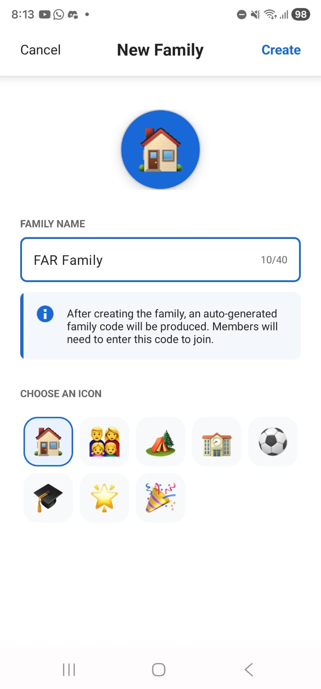<br><b>Create Family (Input)</b></td>
    <td align="center">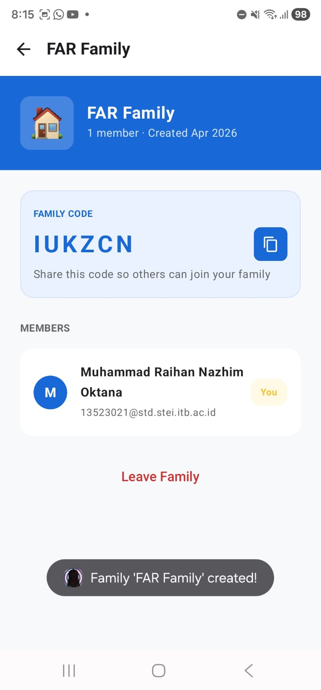<br><b>Create Family (Success)</b></td>
    <td align="center">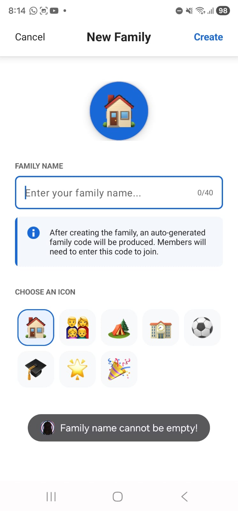<br><b>Create Family (Failed)</b></td>
  </tr>
  <tr>
    <td align="center">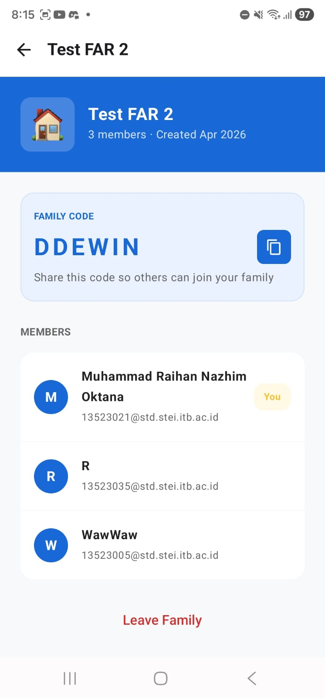<br><b>Family Detail (Joined)</b></td>
    <td align="center"><br><b>Family Detail (Not Joined)</b></td>
    <td align="center">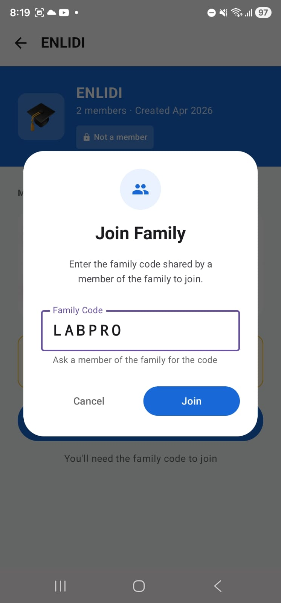<br><b>Join Family (Input)</b></td>
  </tr>
  <tr>
    <td align="center"><br><b>Join (Error Length)</b></td>
    <td align="center">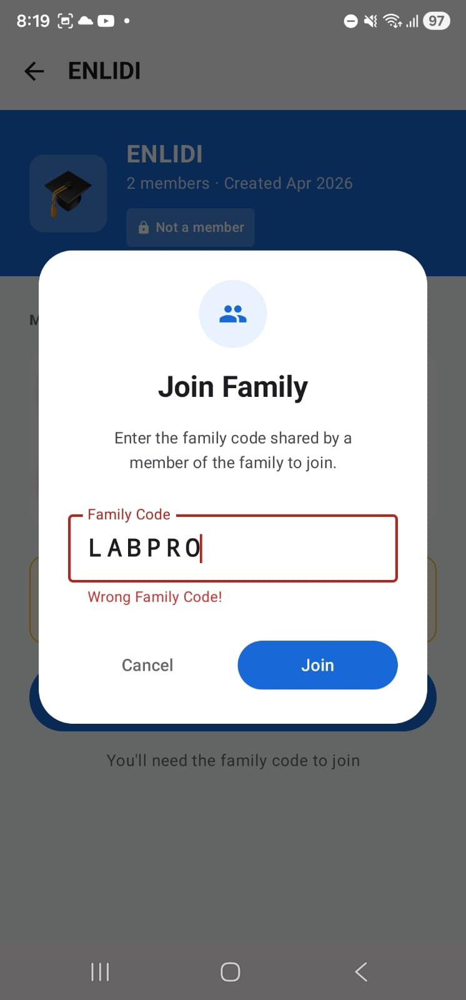<br><b>Join (Wrong Code)</b></td>
    <td align="center">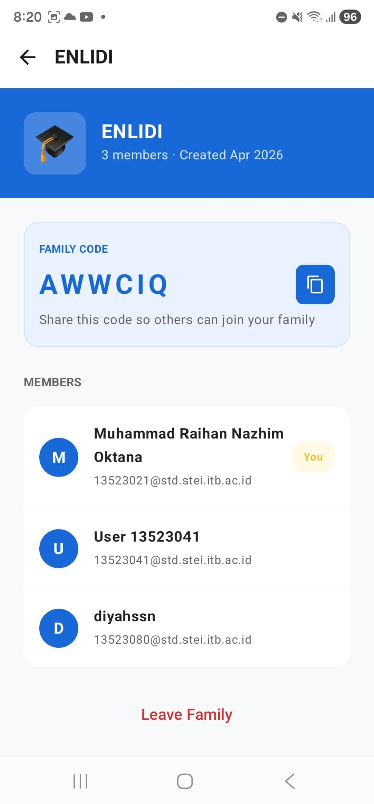<br><b>Join (Success)</b></td>
  </tr>
  <tr>
    <td align="center">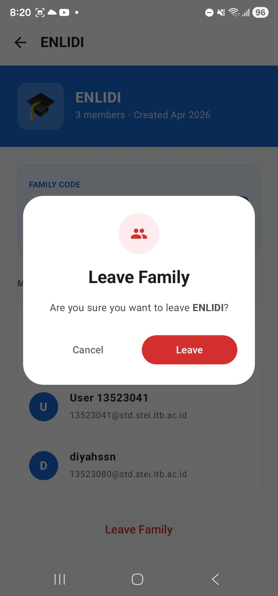<br><b>Leave (Display)</b></td>
    <td align="center">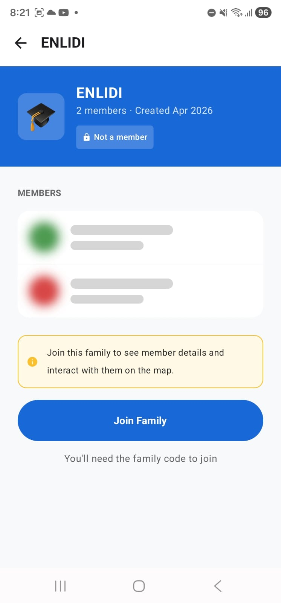<br><b>Leave (Success)</b></td>
    <td align="center">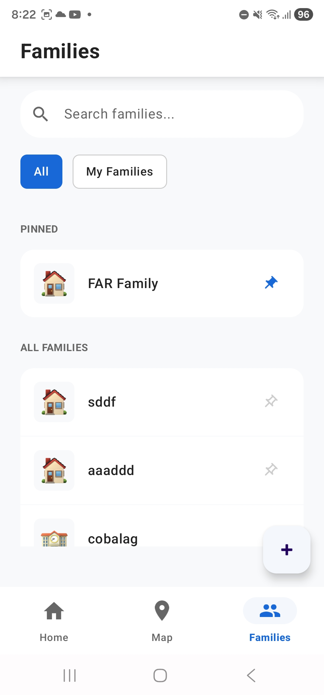<br><b>Pinned (Display >0)</b></td>
  </tr>
  <tr>
    <td align="center">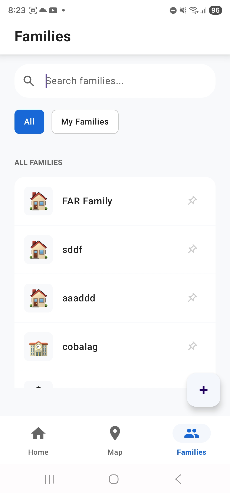<br><b>Pinned (Display =0)</b></td>
    <td align="center">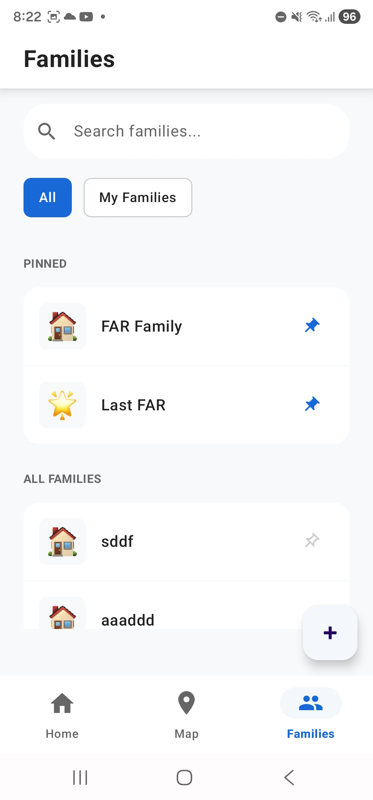<br><b>Pinned (Add)</b></td>
    <td align="center">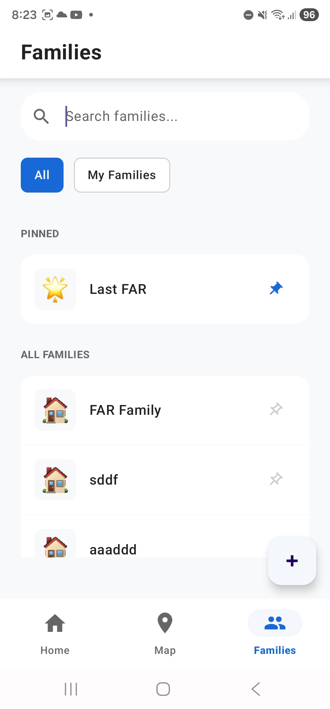<br><b>Pinned (Delete)</b></td>
  </tr>
  <tr>
    <td align="center"><br><b>Filter (All)</b></td>
    <td align="center">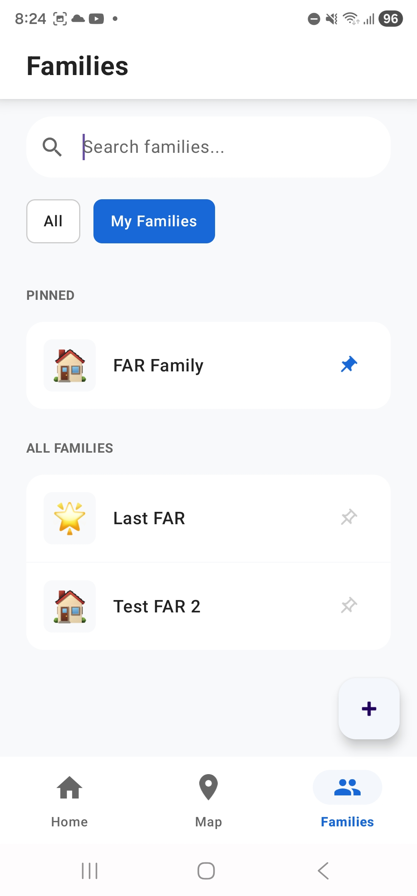<br><b>Filter (My > 0)</b></td>
    <td align="center">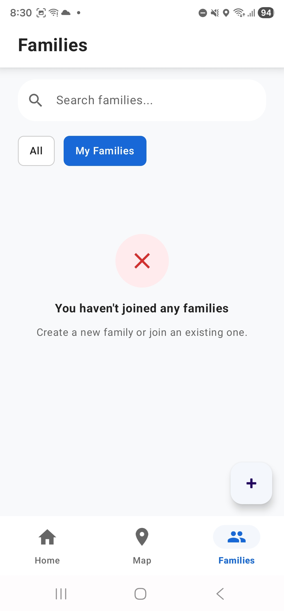<br><b>Filter (My = 0)</b></td>
  </tr>
</table>

### Wajib - Map
<table>
  <tr>
    <td align="center"><br><b>Map (Display)</b></td>
    <td align="center"><br><b>Family Location</b></td>
  </tr>
  <tr>
    <td align="center"><br><b>Phone Orientation A (hadap kiri)</b></td>
    <td align="center"><br><b>Phone Orientation B (hadap kanan)</b></td>
    <td align="center"><br><b>User Information</b></td>
  </tr>
</table>

### Wajib - Profile
<table>
  <tr>
    <td align="center"><br><b>Profile Main</b></td>
    <td align="center"><br><b>Rename Profile</b></td>
    <td align="center"><br><b>Rename (Failed)</b></td>
  </tr>
</table>

### Wajib - Network Sensing
<table>
  <tr>
    <td align="center"><br><b>Disconnected</b></td>
  </tr>
</table>

### Bonus - Search Family
<table>
  <tr>
    <td align="center">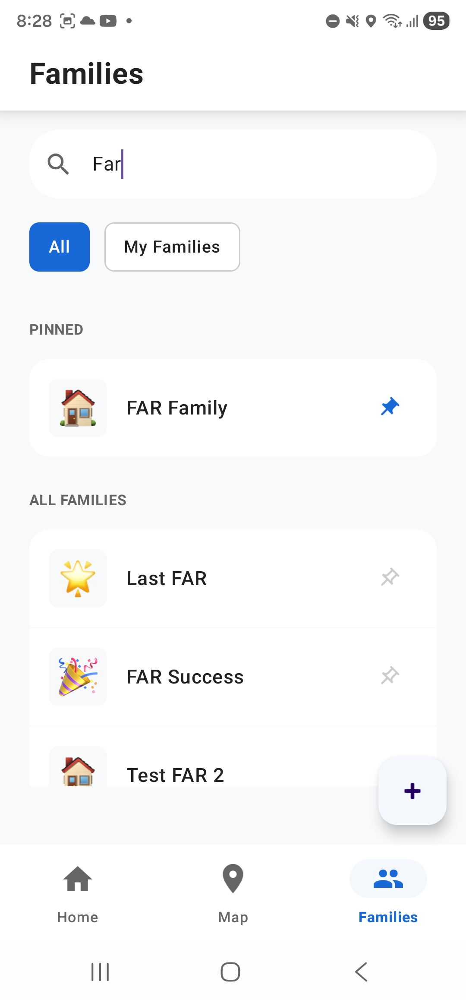<br><b>All (Found)</b></td>
    <td align="center">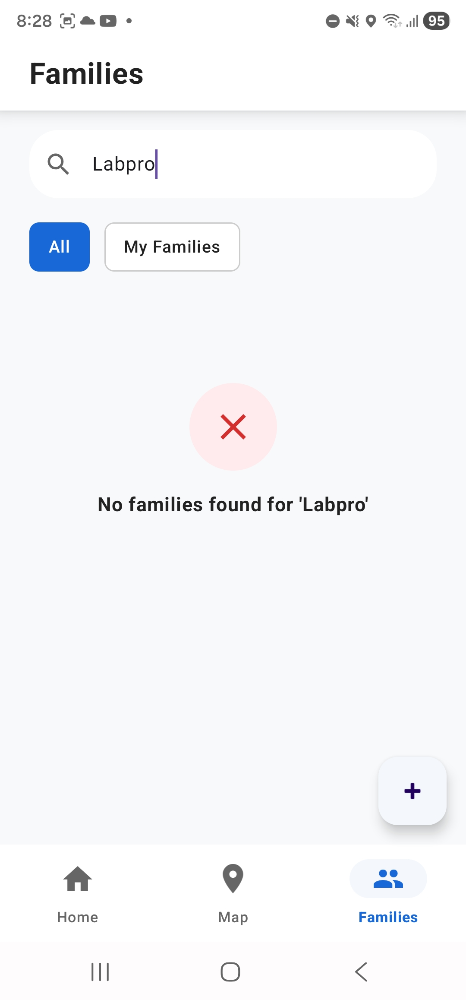<br><b>All (Not Found)</b></td>
  </tr>
  <tr>
    <td align="center">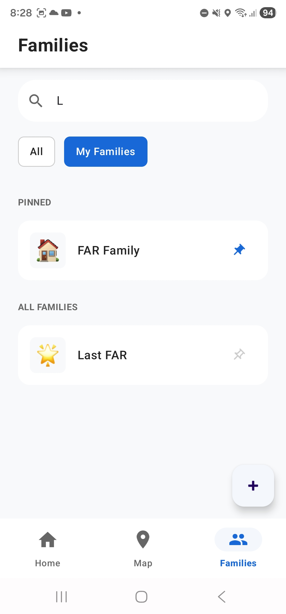<br><b>My (Found)</b></td>
    <td align="center">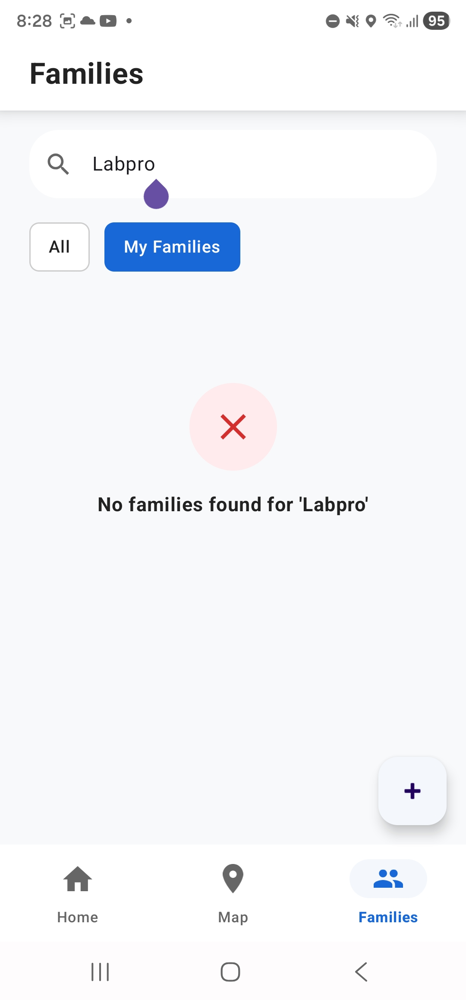<br><b>My (Not Found)</b></td>
  </tr>
</table>

### Bonus - Internet Status
<table>
  <tr>
    <td align="center"><br><b>Internet Status Wi-Fi (Display)</b></td>
    <td align="center"><br><b>Internet Status Cellular (Display)</b></td>
  </tr>
</table>

### Bonus - Mark Favorite Location
<table>
  <tr>
    <td align="center"><br><b>Map View</b></td>
    <td align="center"><br><b>Add (Success)</b></td>
    <td align="center"><br><b>Add (Success)</b></td>
  </tr>
  <tr>
    <td align="center"><br><b>Rename (Success)</b></td>
    <td align="center"><br><b>Rename (Success)</b></td>
    <td align="center"><br><b>Delete (Display)</b></td>
  </tr>
</table>

## Contributors

<table>
  <tr>
    <td align="center">
      <a href="https://github.com/malfansya">
        <br />
        <span><b>Muhammad Alfansya</b></span><br/>
        <p>13523005 </p>
      </a>
    </td>
    <td align="center">
      <a href="https://github.com/RNXFreeze">
        <br />
        <span><b>Muhammad Raihan Nazhim Oktana</b></span><br/>
        <p>13523021</p>
      </a>
    </td>
    <td align="center">
      <a href="https://github.com/grwna">
        <br />
        <span><b>M. Rayhan Farrukh</b></span><br/>
        <p>13523035</p>
      </a>
    </td>
  </tr>
</table>

## Analisis dan Perbaikan Keamanan Aplikasi
### Implementasi Praktik Keamanan
Berikut merupakan cuplikan kode yang menunjukkan implementasi dari masing-masing praktik keamanan pada aplikasi.

- **Input Validation pada Form**:
  Cuplikan kode Input Validation pada form login `LoginActivity.kt`, mencakup validasi kelengkapan data, format email, serta batas panjang minimum dan maksimum untuk mencegah payload berlebih ke server:
  ```kotlin
  var isValid = true

  if (email.isEmpty()) {
      binding.emailInputLayout.error = "Email is required"
      isValid = false
  } else if (email.length > 320) {
      binding.emailInputLayout.error = "Email is too long (max 320 characters)"
      isValid = false
  } else if (!android.util.Patterns.EMAIL_ADDRESS.matcher(email).matches()) {
      binding.emailInputLayout.error = "Invalid email format"
      isValid = false
  }

  if (password.isEmpty()) {
      binding.passwordInputLayout.error = "Password is required"
      isValid = false
  } else if (password.length < 8) {
      binding.passwordInputLayout.error = "Password must be at least 8 characters"
      isValid = false
  } else if (password.length > 128) {
      binding.passwordInputLayout.error = "Password is too long (max 128 characters)"
      isValid = false
  }

  if (isValid) {
      authViewModel.login(LoginRequest(email, password))
  }
  ```

- **Penyimpanan Data Sensitif Secara Aman**:
  Penyimpanan token JWT dilakukan menggunakan `EncryptedSharedPreferences` dengan masterkey hardware-backed Keystore agar data kredensial terenkripsi secara aman.
  Cuplikan kode ada pada `SessionManager.kt`:
  ```kotlin
  private val masterKey = MasterKey.Builder(context).setKeyScheme(MasterKey.KeyScheme.AES256_GCM).build()

  private val sharedPreferences: SharedPreferences =
          EncryptedSharedPreferences.create(
                  context,
                  "auth_prefs",
                  masterKey,
                  EncryptedSharedPreferences.PrefKeyEncryptionScheme.AES256_SIV,
                  EncryptedSharedPreferences.PrefValueEncryptionScheme.AES256_GCM
          )
  ```

- **Penggunaan Koneksi Aman (HTTPS)**:
  Semua komunikasi dengan server backend diarahkan melalui HTTPS untuk koneksi yang aman.
  Pengaturan network security pada `network_security.xml` :
  ```xml
  <?xml version="1.0" encoding="utf-8"?>
  <network-security-config>
      <base-config cleartextTrafficPermitted="false">
          <trust-anchors>
              <certificates src="system" />
          </trust-anchors>
      </base-config>
  </network-security-config>
  ```

- **Error Handling Tanpa Mengekspos Informasi Sensitif**:
  Kode dengan potensi error diamankan menggunakan blok try-catch untuk menampilkan pesan error tertentu atau generik yang ramah pengguna, tanpa mengekspos informasi sensitif ke UI.
  Cuplikan penanganan error pada `ProfileViewModel.kt` untuk menangani pengunggahan foto profil:
  ```kotlin
  else {
      val errorMsg = try {
          val json = org.json.JSONObject(response.errorBody()?.string() ?: "")
          json.getString("message")
      } catch (e: Exception) {
          if (response.code() == 413) "File size is too big (Max 500 KB)" else "Failed to upload photo"
      }
      _profileState.value = ProfileState.Error(errorMsg)
  }
  ```

### Analisis Owasp Top 10 
Analisis keamanan kami lakukan menggunakan tools static analysis yaitu SonarQube. Adapun metrik yang kami perhatikan adalah *Security* dan *Security Hotspot*. Berikut hasil analisis awal dan hasil analisis setelah perbaikan.

#### Hasil Sebelum Perbaikan
<div align="center">
  
</div>

Seperti yang terlihat pada gambar, terdapat 7 issue *Security* dan 5 issue *Security Hotspot*. Adapun issue-issue yang ditemukan adalah sebagai berikut.

**Security**

<div align="center">
  
</div>

Pada gambar hanya 5 issue yang ditampilkan, tetapi 2 issue lainnya adalah "Make sure that intents are received safely here".

**Security Hotspot**

<div align="center">
  
</div>

<br>

**Pengelompokkan Issue**
- M4: Insufficient Input/Output Validation
	- Make sure that intents are received safely here. (`BaseActivity.kt`, `LocationTrackingService.kt`)
  - Make sure that broadcasting intents is safe here.(`AuthInterceptor.kt`, `ProfileActivity.kt`) 
- M8: Security Misconfiguration
	- Make sure that obfuscation is enabled in the release build configuration.
  - Make sure the use of "..." permission is necessary.
  - Dependencies are not verified because the "verification-metadata.xml" file is missing. Make sure it is safe here.
- M9: Insecure Data Storage
	- Tidak ada

#### Perbaikan yang Dilakukan
- **Make sure that intents are received safely here. (`BaseActivity.kt`, `LocationTrackingService.kt`)**
  - `BaseActivity.kt`: `registerReceiver()` tanpa security flag memungkinkan aplikasi lain mengirimkan broadcast ke receiver. Kami memperbaiki ini dengan menambahkan flag `Context.RECEIVER_NOT_EXPORTED`, sehingga receiver hanya menerima broadcast dari dalam aplikasi sendiri. 
  - `LocationTrackingService.kt`: Masalahnya adalah battery receiver dan GPS provider receiver diregister tanpa flag keamanan, sehingga rentan terhadap broadcast injection. Kami perbaiki dengan menambahkan branching `Build.VERSION.SDK_INT >= TIRAMISU` dan menggunakan flag `RECEIVER_NOT_EXPORTED` agar receiver tidak dapat diakses dari aplikasi lain.

- **Make sure that broadcasting intents is safe here.(`AuthInterceptor.kt`, `ProfileActivity.kt`)**
  - Penggunaan `sendBroadcast()` secara default akan mengirim broadcast ke semua aplikasi di device. Namun, kedua file sudah menggunakan `intent.setPackage(context.packageName)` yang membatasi broadcast hanya ke package aplikasi sendiri. Ini merupakan best practice yang direkomendasikan Google sebagai pengganti `LocalBroadcastManager` yang sudah deprecated. Oleh karena itu, issue ini kami nilai sebagai false-positive dari SonarQube, dan kami abaikan.

- **Make sure that obfuscation is enabled in the release build configuration.**
  - Masalahnya ada pada konfigurasi `isMinifyEnabled = false` di build release yang menyebabkan APK berisi nama class, method, dan field yang masih dapat dibaca, sehingga mudah di-reverse engineer. Kami perbaiki dengan mengubah `isMinifyEnabled` menjadi `true` dan menambahkan `isShrinkResources = true` pada `build.gradle.kts`. Dengan ini, R8/ProGuard akan melakukan obfuscation pada APK release. File `proguard-rules.pro` juga diperbarui dengan keep rules yang diperlukan agar model Retrofit dan library lainnya tetap berfungsi.

- **Make sure the use of "..." permission is necessary.**
  - Kami nilai izin yang diperlukan aplikasi memang benar-benar diperlukan oleh fitur aplikasi, sehingga kami tandai ini sebagai Safe.

- **Dependencies are not verified because the "verification-metadata.xml" file is missing. Make sure it is safe here.**
  - Tanpa file `verification-metadata.xml`, Gradle tidak memverifikasi checksum dependency yang diunduh sehingga berpotensi terjadi supply chain attack. Untuk memperbaiki, perlu menghasilkan file besar yang harus di-maintain setiap kali dependency di-update. Oleh karena itu, kami pilih untuk tidak memperbaikinya (tandai Safe).

#### Hasil Setelah Perbaikan
<div align="center">
  
</div>

Seperti yang terlihat pada gambar, issue *Security* dan *Security Hotspot* telah berkurang menjadi 0.
